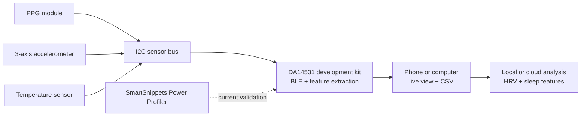

# DA14531 Sleep Sensing Evaluation Platform

DA14531 Sleep Sensing Evaluation Platform is an engineering project built around the Renesas DA14531 SmartBond TINY Module Development Kit. It combines off-the-shelf optical, motion and temperature sensors to demonstrate a complete BLE data path from physiological signal acquisition to sleep-related feature analysis.

The repository presents the project concept, technical architecture and public reference material. Firmware, applications and validation results will be added as the prototype develops.

## Planned capabilities

- PPG and motion acquisition through an I2C sensor bus.
- Body-surface temperature trend measurement.
- On-device heart rate, RR interval, HRV, activity and signal-quality features.
- BLE raw-data and feature-data services.
- Live visualization and CSV export on a phone or computer.
- Replayable sleep and wake analysis, with light/deep sleep analysis treated as research-grade output.
- Current-consumption characterization using SmartSnippets Toolbox Power Profiler.

## System overview

## Repository contents

- [Project overview](docs/project-overview.md)
- [System architecture](docs/architecture.md)
- [Hardware platform](hardware/README.md)
- [Firmware and SDK references](docs/firmware-references.md)
- [Related research literature](docs/literature.md)
- [Reference index](references/README.md)

## Project status

The project is at the concept and technical-framework stage. The repository is intended for engineering documentation and educational collaboration. It does not contain a certified medical device, a commercial wearable design or clinical performance claims.

## Intended use and limits

This project is for engineering evaluation, education and research prototyping. It is not intended for diagnosis, treatment or clinical decision-making. Heart rate, SpO2, temperature and sleep-stage outputs must not be presented as medical conclusions without appropriate validation and regulatory review.

## License and third-party material

No open-source license has been applied to the original project material yet. Third-party SDKs, datasheets and papers remain subject to their own licenses and terms.
