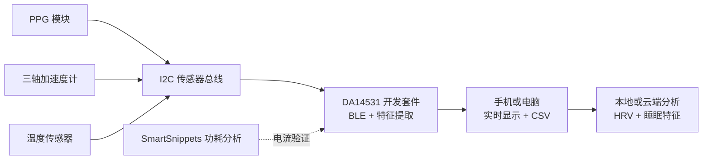

**[简体中文](README.md) | [English](README.en.md)**

# DA14531 睡眠生理采集与算法验证平台

本项目围绕 Renesas DA14531 SmartBond TINY Module Development Kit，使用现成的光学、运动和温度传感器，演示从生理信号采集到睡眠相关特征分析的完整 BLE 数据链路。

仓库目前用于发布项目概述、系统架构、技术参考和公开研究文献。固件、应用程序和验证结果将在原型开发过程中逐步加入。

## 计划能力

- 通过 I2C 传感器总线采集 PPG 和体动。
- 测量体表温度趋势。
- 在设备端提取心率、RR 间期、HRV、活动量和信号质量。
- 提供原始数据和特征数据 BLE 服务。
- 在手机或电脑端实时显示并导出 CSV。
- 支持数据回放、睡眠/清醒分析，以及研究性浅睡/深睡分析。
- 使用 SmartSnippets Toolbox Power Profiler 评估不同状态的电流消耗。

## 系统概览

## 仓库内容

- [中文项目概述](docs/project-overview.zh-CN.md)
- [系统架构](docs/architecture.md)
- [硬件平台](hardware/README.md)
- [固件与 SDK 参考](docs/firmware-references.md)
- [中文相关研究文献](docs/literature.zh-CN.md)
- [资料索引](references/README.md)

## 项目状态

项目目前处于概念和技术框架阶段。仓库用于工程记录、技术交流和教育演示，不包含已认证的医疗器械、商业可穿戴产品或临床性能声明。

## 使用边界

本项目用于工程评估、教学和研究原型。它不用于疾病诊断、治疗或临床决策。心率、血氧、温度和睡眠阶段结果，在没有完成适当验证和法规审查前，不得作为医学结论发布。

## 许可与第三方资料

项目原创内容目前尚未指定开源许可证。第三方 SDK、数据手册和论文分别遵循其原有许可和使用条款。
