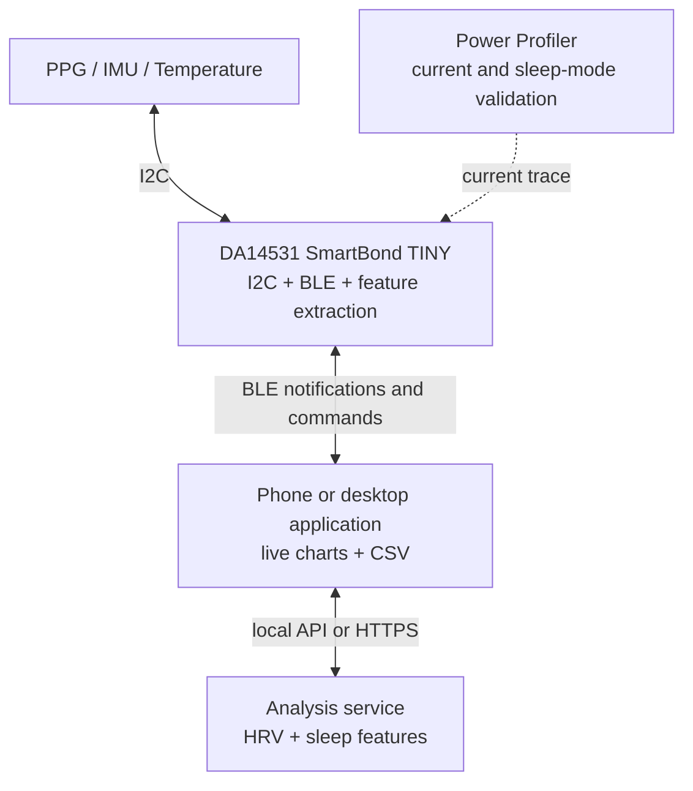

# System Architecture

## Overview

The platform uses the DA14531 development kit as the central BLE controller and sensor host. Sensor modules are connected through the development kit's I2C interface. The host application receives raw and processed data, stores it for replay and produces sleep-related reports.

## Data layers

1. **Sensor layer**: PPG FIFO, three-axis acceleration and temperature readings.
2. **Device layer**: signal-quality checks, peak detection, RR intervals, HRV, activity counts and feature windows.
3. **Transport layer**: raw-sensor packets for diagnostics and compact feature packets for normal operation.
4. **Host layer**: live visualization, recording, replay, CSV export and analysis.

## BLE service model

| Service or characteristic | Direction | Purpose |
| --- | --- | --- |
| Raw Sensor Packet | Notify | Sequence, timestamp, raw sensor values and quality flags |
| Sleep Feature Packet | Notify | 30-second HR, HRV, motion, temperature and status summary |
| Control Command | Write | Start/stop recording and sampling-mode selection |
| Heart Rate | Notify | Standard BLE heart-rate interoperability |
| Device Status | Read / Notify | Firmware version, sensor health and packet-loss counters |

## Analysis boundary

The initial analysis targets sleep/wake state, sleep duration and related trends. Light/deep sleep classification is research-oriented and must be evaluated against reference data before any accuracy claim is made.
